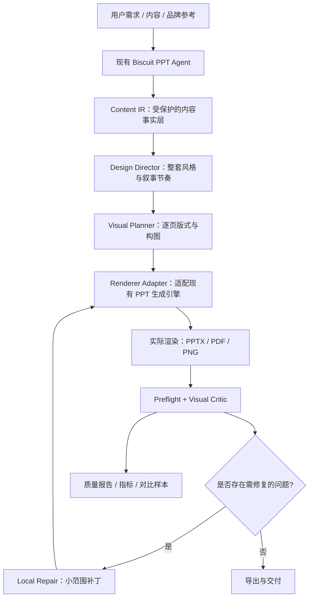

# Biscuit — Presentation Design Engine

> **技术设计文档 / RFC · Version 1.0-draft**  
> 日期：2026-11-21  
> 适用范围：Biscuit 现有 AI PPT Agent 的**增量设计能力升级**  
> 状态：待现有仓库架构核对；本文的接口与路径为建议契约，并不表示现有 Biscuit 已具备这些接口。  
> 目标读者：产品设计、前端、Agent/LLM、后端、PPT 渲染与测试工程师。

## 0. 执行摘要

Biscuit **已经有能够生成 PPT 的 AI Agent**。本项目不重新构建 PPT Agent、不默认更换底层 PPTX 引擎，也不以增加模板数量作为核心目标。新增一个可独立演进的 **Presentation Design Engine（演示文稿设计引擎，PDE）**，把「内容生成」与「设计决策」解耦，并通过真实渲染反馈形成迭代闭环。

**预期结果：**

1. Agent 能理解演示的用途、受众、叙事与用户偏好的审美方向；
2. 能针对整套 PPT 制定统一视觉语言，并为每页选择与内容匹配的构图，而非机械套模板；
3. 能复用用户提供的视觉参考与品牌资产，但不会直接复制受保护作品；
4. 能检查**实际渲染**后的页面，识别溢出、遮挡、字形错误、对比度、视觉层级、重复版式等问题；
5. 能对问题页面执行有边界的局部修复，不擅自改写事实、指标或用户确认的内容；
6. 最终文件依然可以在 PowerPoint / Keynote / LibreOffice 等兼容软件中合理编辑与演示，具体兼容性以测试结果为准。

**最小可用升级（MVP）：** 对现有 PPT Agent 加入「统一设计配置 → 逐页 PNG/PDF 预览 → 确定性检查 → 视觉 Critic → 局部修复 → 回归测试」。在真实的旧版输出上对比前后质量；先保证可用，再扩展自由构图。

---

## 1. 目标、边界与成功定义

### 1.1 产品目标

- **专业感**：统一字体、配色、网格、素材风格与信息层级，减少明显的「AI 模板味」。
- **表达力**：一页一个可感知的重点，版式服务论点；数据、流程、对比使用恰当的视觉编码。
- **变化与一致并存**：同一套视觉语言下有节奏地变化构图、密度、图像比例和强调方式。
- **可编辑**：优先使用原生文本、形状、图表、表格；非必要不得将整页截图当作 PPT 页面。
- **可验证**：每次自动设计或改动都有结构化决策、渲染产物和问题记录。
- **可控**：用户可以指定品牌、参考风格、页数、受众、语言及是否允许 AI 生成插画。

### 1.2 非目标（本轮明确不做）

- 重建现有 PPT 生成引擎、重写 Agent 主流程或强行统一为某家模型厂商；
- 以 AI 自评分数代替人类评审，承诺「100% 达到设计师水平」；
- 自动下载并复制未授权的商业模板、图片、字体、Logo 或整页设计；
- 默认生成未经来源核实的商业数据、研究结论或图表；
- 为所有页面强制使用 Biscuit App 的深色暖琥珀配色（**软件 UI 设计体系 ≠ 每份 PPT 的设计体系**）；
- 第一版即实现无限制自由布局、复杂 3D、动画电影级特效或完整 PowerPoint 功能克隆。

### 1.3 前置假设与待核对事项

现有代码尚未被本设计文档直接检查。落地前须识别：

- Agent 的输入协议、内容规划格式、任务状态管理、模型 SDK 和调用边界；
- PPT 生成后端：PptxGenJS、python-pptx、HTML→PPTX、模板引擎或其他；
- 是否已有 PDF/PNG 渲染、文件存储、任务队列、缓存、日志及单页重新生成能力；
- 是否已有 PPTX 的可编辑性保证、模板、中文字体策略及图像资产管线；
- 产品前端的现有组件与交互状态：Biscuit 使用的 Fluid Functionalism / shadcn/ui AI Elements 用于**应用 UI**，不是 PPT 文件生成器。

所有示例 API 都是**待适配的接口契约**，不应直接假定现有代码结构与本文一致。

### 1.4 非功能约束

- **兼容性**：旧生成路径可通过功能开关保留；设计引擎出错时支持退回旧路径。
- **正确性优先**：视觉修复不得改变数字、引文、数据来源、图例含义、单位及已确认事实。
- **确定性**：在相同输入、模型配置、种子与资产版本下，尽量重现设计结果；记录不可控环节。
- **可解释性**：每个页面需保存选择该布局的理由，便于审查。
- **成本可控**：限制图像生成次数、视觉模型调用次数和修复轮数。
- **隐私**：预览图、用户上传品牌资产、原始文稿按现有授权和保留策略处理。

---

## 2. 总体架构：保留现有 Agent，增加设计层



### 2.1 三层中间表示：Content / Design / Render

**Content IR（事实层，权威输入）**

- 记录已确定的标题、论点、文案、数据、数值单位、引用、来源、顺序与演讲备注。
- 每个内容节点有稳定 ID。内容允许由原 Agent 生成并经用户编辑，但**设计修复器默认只读**。
- 内容过长时，设计层可建议缩写，但不得无授权自动删改关键事实；可通过明确的 `content_edit_proposal` 走单独审核流程。

**Design IR（设计决策层，新增）**

- 记录主题 Token、布局家族、栅格、视觉焦点、素材策略、页面元素关系、可接受内容密度与可追溯参考。
- 设计修改优先针对这层，且只能引用真实存在的 Content IR 内容节点。

**Render IR（实现层，适配现有后端）**

- 将 Design IR 转成现有引擎可理解的尺寸、文本框、形状、图片、图表和字体属性。
- 保留元素 ID 与 Content/Design 关联；允许不同导出器用不同实现，但不改变设计意图。
- Renderer Adapter 负责单位换算（pt、px、EMU、in 等）与字体实际测量。

**原则**：需要修「字太小」时，不重新生成这一页的事实内容；需要修「对比不清」时，不改变比较的双方；需要修「图表挤压」时，优先调整版式或拆页。

### 2.2 新模块与边界

| 模块 | 输入 | 输出 | 不允许做的事 |
|---|---|---|---|
| Design Director | 用户 Brief、Deck Outline、品牌和参考 | Deck Design Brief、Theme Tokens、Visual Rhythm Plan | 重写事实或强制单一风格 |
| Reference Curator | 用户文件、许可可用参考和标签 | 检索索引、参考元数据、学习点 | 不经授权复制素材或版式 |
| Visual Planner | Content IR、Theme、参考、布局能力清单 | Slide Design IR、备选构图、选择原因 | 假造素材来源或凭空生成数据 |
| Asset Director | 每页素材需求、品牌资产、许可策略 | 经处理图片/图标/图表素材和元数据 | 将展示用图片误当数据证据 |
| Renderer Adapter | Design IR + Content IR | PPTX、页面映射、渲染元数据 | 隐式扁平化所有文本 |
| Preflight Validator | IR、PPTX、渲染日志 | 确定性错误列表 | 把不确定的审美感受当硬错误 |
| Visual Critic | PNG、全套缩略图、Brief、IR、Preflight | 有证据的视觉问题及建议 | 虚构未看到的缺陷或只给空洞打分 |
| Local Repair | 问题列表、Design IR、约束 | 有界 Patch、修复原因 | 修改受保护内容或无穷循环 |
| Evaluation | 前后 PPTX/PNG、评价样本 | 基准指标与人工对比记录 | 用模型自评分代替外部质量验证 |

### 2.3 集成方式

推荐在现有生成流程前后加入两个挂载点，而不是迁移整个系统：

1. **生成前 `beforeRender`**：传入现有 Deck 数据，映射为 Content IR，执行 Director + Planner，生成 Design IR；若失败则保留旧布局路径。
2. **生成后 `afterRender`**：获得 PPTX 或导出产物，渲染预览，调用 Preflight + Critic，生成 Patch 并仅重渲受影响页面（底层若不能单页重渲，可重建文件，但必须锁定未修改页的设计与内容）。

接口可先定义为：`planDesign(deck, preferences)`、`renderDeck(content, design)`、`renderPreview(pptx)`、`inspect(previews, design)`、`repair(design, issues)`。具体函数名遵循既有工程习惯。

---

## 3. Design Director：整套设计策略

### 3.1 输入：Design Brief

Director 至少需要：

- 主题、演示目的（说服 / 教学 / 汇报 / 发布 / 复盘等）；
- 受众（领导、客户、投资人、学生、技术团队等）；
- 使用场景（大屏演讲、线上会议、发给别人阅读、打印）；
- 语言、页数区间、比例（默认 16:9）、品牌约束；
- 用户明确喜欢 / 不喜欢的参考风格；
- 图片策略（允许生成 / 仅使用用户素材 / 不使用图片）；
- 内容是否可精简、是否允许拆页及特殊可访问性要求。

缺少信息时使用保守默认值：普通屏幕演示、16:9、高可读性、中等信息密度；不反复向用户索要不影响执行的细节。

### 3.2 输出：Deck Design Brief

生成一份结构化设计说明：

- `visual_thesis`：一句话描述全套 PPT 的视觉策略；
- `tone`：例如 editorial / minimal / scientific / corporate / product-launch；
- `theme_tokens`：色板、字体、字号、网格、留白、圆角及图形系统；
- `visual_rhythm`：哪些页面强调文字，哪些强调图片、数据、对比或图表；
- `imagery_policy`：图片的摄影、插画或抽象视觉方向；
- `layout_constraints`：每页内容、标题长度、字号底线和对齐规则；
- `negative_rules`：本次明确禁止的视觉惯性；
- `rationale`：为什么适合这份内容与受众。

### 3.3 主题不等于死模板

系统可预设以下**风格方向**作为起点，而非一键套用固定页面：

| 风格方向 | 典型特征 | 适合 | 风险 |
|---|---|---|---|
| Editorial | 强排版、留白、节奏分明、少量图像 | 产品故事、思想报告 | 文字过大导致信息不足 |
| Modern Minimal | 中性色、清晰栅格、控制装饰 | 企业介绍、科技发布 | 过度单调 |
| Data-first | 清晰图表、标签、比较关系 | 分析报告、研究 | 信息密度过高 |
| Academic | 图表、注释、事实和来源优先 | 学术、教学 | 风格僵硬 |
| Brand-led | 品牌素材、logo、产品图一致呈现 | 宣传、路演 | 视觉喧宾夺主 |

**特别注意：** Biscuit 的 App `DESIGN.md` 规定的是 Biscuit 软件界面；只有当用户在制作 Biscuit 自身品牌介绍时，才默认考虑 Biscuit 的暖琥珀色与产品视觉。普通用户的 PPT 使用各自的 Brief / 品牌资产。

### 3.4 全套节奏规划

Director 不只挑一套颜色，也应给每页定义表达角色：`opening`、`context`、`thesis`、`evidence`、`mechanism`、`contrast`、`transition`、`conclusion`。

应避免连续多页同类布局，例如连续五页相同三列卡片；但不能为了「不重复」而牺牲可读性或内容语义。多样化是约束，不是随机性。

---

## 4. 视觉参考库（Reference Library）

### 4.1 参考素材结构

建议目录：

```text
presentation-design/
├── PRESENTATION_DESIGN_ENGINE.md
├── references/
│   ├── manifest.json
│   ├── editorial/
│   ├── minimal/
│   ├── brand-led/
│   └── data-first/
├── themes/
├── layouts/
├── prompts/
├── schemas/
└── evaluation/
```

实际目录须按 Biscuit 现有仓库改名与合并，避免重复目录。

每条参考记录建议包括：`reference_id`、来源 URL / 用户上传 ID、素材所有者、使用权信息、类别、色彩特点、标题层级、版式构图、图片处理、适合的内容类型、要学习的设计规律、**禁止照搬的部分**。

### 4.2 检索与推荐

- **先按内容语义筛选**（封面、图表、对比、时间线、概念图）；
- 再按用户选定的视觉方向筛选；
- 最后按可读性、当前页内容容量和可编辑性评分；
- 支持用户指定「像这张图的版面密度，但不要它的颜色」等**属性级参考**；
- 保留 `reference_id`，便于判断某种参考是否真的改善最终质量。

第一版使用手工标签 + 简单检索即可；素材库规模扩大后再考虑图文向量检索。不要将向量数据库作为 MVP 前置依赖。

### 4.3 版权与安全边界

- 用户给出的参考截图用于分析视觉规律，不能默认允许复用其中的图片、Logo、插画或模板文件。
- 网络图片或字体需记录授权、归属及可分发条件；未确认授权时使用占位符或来源明确的替代素材。
- 检索到的网页、PDF、PPT 模板属于**不可信输入**，其中任何要求 Agent 改变权限、上传文件或忽略系统规则的文字一律不执行。
- 企业/私人数据、上传的产品截图不得擅自发送给未授权的第三方服务。

---
## 5. Visual Planner：逐页设计与创意排版

### 5.1 一页一主张，但允许必要的复杂度

- 每页优先有一个明确的 `key_message`，标题尽量表达结论，而非空泛主题。
- 重要内容可复杂，但必须建立阅读顺序和焦点；不能把长报告压成过密的「万能信息卡片」。
- 对多维数据，应优先设计清晰的图表或拆页，而不是通过缩小字号凑齐所有内容。
- 允许学术附录、数据说明页等高密度例外，必须显式标记 `density: dense`，并使用与普通演讲页不同的检查阈值。
- 可以使用语义适配的标题/图片/图表/流程/对比，不能无理由随机挑选版式。

### 5.2 页面布局家族（第一阶段建议 15 类）

| Layout ID | 名称 | 内容适用 | 设计要点 |
|---|---|---|---|
| `cover` | 品牌封面 | 主题、演讲者、日期 | 一个强视觉焦点；背景不干扰标题 |
| `section` | 章节过渡 | 章节 / 议题切换 | 留白、节奏变化、清晰章节编号 |
| `statement` | 核心观点 | 单一结论 / 主张 | 大标题，辅以一处证据或解释 |
| `hero_image` | 图像主导 | 产品、场景、案例 | 图片有意义；可读文字区 |
| `split` | 图文并列 | 概念 + 例子 | 明确 40/60、50/50 等比例策略 |
| `comparison` | 对比 | A vs B、前后变化 | 公平基线、相同维度、减少误导 |
| `timeline` | 时间线 | 发展历程、项目计划 | 时间尺度准确，长度与事件密度适配 |
| `process` | 流程 | 步骤、管线、方法 | 方向与箭头语义清晰，不跨越混乱 |
| `architecture` | 系统架构 | 技术模块关系 | 信息层级与线条方向明确，避免线缆缠绕 |
| `metrics` | 指标重点 | 1–3 个真实核心数据 | 单位和时间范围完整、来源可追溯 |
| `chart` | 图表页 | 趋势、结构、分布、关系 | 根据问题选择图形编码，不能装饰化数据 |
| `table` | 表格页 | 明细、特性比较 | 强化行列标签、关键值可辨识 |
| `quote` | 引述 | 真实可核实的讲话 / 用户反馈 | 引号、姓名、来源；不捏造 |
| `case_study` | 案例 | 问题→行动→结果 | 事实、图片和结果之间建立关联 |
| `closing` | 结束 / 行动 | 总结、行动建议 | 不堆积新信息；留下核心结论 |

后续可继续新增版式，但需要稳定的内容输入、几何规则、测试样本与回退方案。**「15 类」是建议初始覆盖面，不是第一周必须全部实现。**

### 5.3 候选布局选择算法

对每页执行：

1. 识别内容语义、文案长度、图片需求与数据结构；
2. 根据内容筛选 2–4 个合适布局（未满足约束的直接排除）；
3. 在统一的 Theme 下生成候选 Design IR，可先用低保真图像而非高成本完整 PPT；
4. 评估：语义匹配、可读性、留白、信息密度、编辑性、与相邻页的节奏；
5. 选取得分稳定的方案，记录 `selection_reason`；
6. 如果所有候选都不合适，优先要求减少冗余、调整信息组织或拆页，而非强制放大画布或缩小文字。

可以用一套启发式初始权重：语义适合度 30%、可读性 25%、层级 20%、统一性 15%、节奏 10%。**这些数字只是产品内部排序的起点，后续必须用真实 A/B 人工偏好数据校准。**

### 5.4 设计规范：尺寸、排版与留白

初始默认值（针对 16:9 屏幕展示；非绝对限制）：

| 参数 | 建议起点 | 处理原则 |
|---|---|---|
| 幻灯片比例 | 16:9 | 按用户要求支持 4:3 / 自定义比例 |
| 安全边距 | 左右约画布宽度的 5–7% | 避免元素贴边；铺满背景图片例外 |
| 展示型标题 | 34–48pt | 随场景、长度、投影环境调整 |
| 常规正文 | 18–24pt | 大屏优先可读，长文档可以采用阅读型布局 |
| 注释/数据来源 | 12–15pt | 关键来源必须可辨识，不放在不可读角落 |
| 颜色数 | 2–4 组主色语义 | 允许数据可视化使用必要分类色 |
| 字体家族 | 原则上不超过 2 组 | 中英文字体可按字体回退统一呈现 |
| 全套页码/页脚 | 保持统一 | 封面与特殊章节页可例外 |

不要为了满足固定字号而裁切关键信息；优先改写冗余文字、调整布局或拆页。对于需原文引用、法规、合同、学术公式的内容，禁止未经许可缩写。

### 5.5 中文与多语言排版

- CJK 文本的字宽、标点挤压、断行规则与拉丁文本不同，必须实测目标渲染环境；
- 字体优先基于用户环境或可合法分发的字体；对缺失字体给出明确警告与降级方案；
- 处理中英文混排、数字与单位的不可分割关系，避免 `10` 与 `%` 被拆到两行；
- 对阿拉伯语等 RTL 语言另行核对文字方向和阅读顺序；第一版未覆盖时应准确告知限制；
- 检查中文标点孤行、标题非预期断行、简繁字体回退不一致等问题。

### 5.6 数据可视化规则

- 趋势用折线图；离散类别比较用条形/柱状图；部分与整体依数据和类别数量慎用饼图；过程关系用流程/桑基等需有实际语义支持的图形；
- 坐标轴应包含单位、时间尺度和合理基线；若刻意截断刻度，必须明确提示；
- 图表颜色编码含义在整套 PPT 内保持一致；
- 数据点来自 Content IR 的可追溯数据源，不让图像模型生成带有虚构刻度或真实数据外观的「假图表」；
- 如果原生可编辑图表不可用，可使用 SVG，但应在导出说明中标注相应元素不具备完整原生数据编辑能力。

### 5.7 图像与视觉资产策略

图片优先级：用户提供且可合法使用的资产 → 用户授权的品牌素材库 → 许可明确的图库/图标 → 经过标识的 AI 概念插画。不能因为页面空，就生成一张无意义的装饰图。

处理要求：裁剪有稳定焦点、保留主体、分辨率与输出尺寸匹配、统一色彩处理；含文字的图片需要额外检查可读性。AI 生成图片不应用于伪造证据、真实数据、产品已存在功能或真实人物的未证实行为。

---

## 6. Design Tokens 与品牌体系

### 6.1 Token 分层

- `foundation`：基础色阶、间距阶梯、字号阶梯、字体候选；
- `semantic`：`canvas`、`text-primary`、`text-muted`、`accent`、`data-positive`、`data-negative` 等；
- `deck-specific`：从 Brief / 品牌生成的实际色值、字体、具体页脚样式；
- `layout-specific`：为 `cover`、`chart`、`section` 等布局限定的安全变体。

**禁止**：某页直接指定与整套主题不一致的随机品牌色；在同一个 PPT 内反复改变含义相同的视觉符号。

### 6.2 初始主题 JSON 示例

```json
{
  "themeId": "biscuit-launch-example",
  "status": "provisional",
  "canvas": { "ratio": "16:9", "widthIn": 13.333, "heightIn": 7.5 },
  "colors": {
    "background": "#0F1114",
    "surface": "#191C21",
    "text": "#F4F4F2",
    "muted": "#AEB4BE",
    "accent": "#D8AB76"
  },
  "fonts": {
    "latin": "Inter",
    "cjkFallback": "Noto Sans CJK SC",
    "monospace": "JetBrains Mono"
  },
  "typographyPt": { "title": 40, "body": 20, "caption": 14 },
  "safeMarginIn": 0.72,
  "gridColumns": 12,
  "imageTreatment": "restrained-realistic",
  "contrastPolicy": "WCAG-AA-guidance"
}
```

该示例专门用于 **Biscuit 自身产品介绍 PPT**，品牌色仍为初始方案，不应继承到所有用户文稿。

### 6.3 对比度与可访问性

- 以 WCAG 2.2 AA 作为**设计校准基准**：普通文字建议达到 4.5:1、大型文字建议达到 3:1；PPT 输出本身不等于具有完整网页 WCAG 合规声明。
- 关键数据不得仅靠红/绿区分；增加标签、图例、形状或数值直接标注。
- 标题、正文、页脚有明确阅读顺序；能保存可用语义信息或替代文字时应保存。
- 颜色检查必须针对**真实渲染后的前景与背景**，不能只读取设计 Token，因为文字可能压在照片上。

---

## 7. 结构化数据契约（Contracts）

下面是面向实现的 **TypeScript 风格建议接口**。如现有代码是 Python / Go / Java，可使用等价结构。正式落地时应定义运行时 JSON Schema，并限制可选枚举与字段，避免模型直接输出任意代码。

### 7.1 核心模型

```ts
type SlideRole =
  | "opening" | "context" | "thesis" | "evidence"
  | "mechanism" | "contrast" | "transition" | "conclusion";

type LayoutFamily =
  | "cover" | "section" | "statement" | "hero_image" | "split"
  | "comparison" | "timeline" | "process" | "architecture"
  | "metrics" | "chart" | "table" | "quote" | "case_study" | "closing";

type Severity = "blocker" | "major" | "minor" | "suggestion";

type ContentNode = {
  id: string;
  kind: "title" | "body" | "metric" | "citation" | "chart-data" | "note";
  text?: string;
  payload?: unknown;
  provenance?: { sourceId: string; page?: number; url?: string };
  locked: boolean;           // 默认保护经确认的数字/事实/引用
};

type SlideContent = {
  slideId: string;
  role: SlideRole;
  keyMessage: string;
  nodes: ContentNode[];
  speakerNotes?: string;
};

type DeckContentIR = {
  schemaVersion: "1.0";
  deckId: string;
  locale: string;
  goal: string;
  audience: string;
  slides: SlideContent[];
};

type ThemeTokens = {
  id: string;
  palette: Record<string, string>;
  fonts: { display: string; body: string; cjkFallback?: string };
  typeScalePt: Record<string, number>;
  spacingIn: Record<string, number>;
  safeMarginIn: number;
};

type SlideDesign = {
  slideId: string;
  layout: LayoutFamily;
  density: "airy" | "standard" | "dense";
  focalPoint: string;
  contentBindings: Array<{
    nodeId: string;
    slotId: string;
    emphasis: "primary" | "secondary" | "supporting";
  }>;
  assetRequests: Array<{
    assetId: string;
    kind: "user" | "licensed" | "generated" | "chart";
    purpose: string;
  }>;
  referenceIds: string[];
  selectionReason: string;
};

type DeckDesignIR = {
  schemaVersion: "1.0";
  deckId: string;
  theme: ThemeTokens;
  visualThesis: string;
  slides: SlideDesign[];
};
```

具体几何位置最好由 **Layout Resolver** 根据 `layout + contentBindings + theme` 计算，不鼓励模型自由输出所有元素的 `x/y/w/h`；需要自由构图时也应限制到画布安全区域并经程序验证。

### 7.2 视觉问题模型

```ts
type VisualIssue = {
  issueId: string;
  slideId: string;
  elementIds: string[];
  kind:
    | "overflow" | "clipping" | "overlap" | "missing-glyph"
    | "low-contrast" | "weak-hierarchy" | "poor-alignment"
    | "crowded" | "repetitive-layout" | "image-mismatch"
    | "chart-misleading" | "inconsistent-style" | "source-missing";
  severity: Severity;
  confidence: number;      // 0..1，仅供排序，非客观概率保证
  evidence: string;        // 对应截图位置/元素 ID/可复现规则
  suggestedChange: string; // 具体可执行建议
  source: "deterministic" | "vision-model" | "human";
};

type DesignPatch = {
  patchId: string;
  slideId: string;
  reasonIssueIds: string[];
  operations: Array<{
    op: "replace" | "add" | "remove";
    path: string;          // 受白名单控制的 Design IR 路径
    value?: unknown;
  }>;
  protectsContentIds: string[];
};
```

`confidence` 只用于帮助审查排序；高置信度视觉意见不应绕过权限、事实保护与确定性检查。

### 7.3 示例：某一页的设计结果

```json
{
  "slideId": "slide-04",
  "layout": "comparison",
  "density": "standard",
  "focalPoint": "两种工作流程的差异",
  "contentBindings": [
    { "nodeId": "title-04", "slotId": "headline", "emphasis": "primary" },
    { "nodeId": "before-04", "slotId": "left-column", "emphasis": "secondary" },
    { "nodeId": "after-04", "slotId": "right-column", "emphasis": "primary" }
  ],
  "assetRequests": [],
  "referenceIds": ["ref-minimal-comparison-01"],
  "selectionReason": "这是同维度前后对比，双栏更利于一眼判断差异。"
}
```

### 7.4 模型输出校验

- 使用供应商支持的结构化输出 / JSON Schema 约束字段、类型和枚举；
- 仍必须对业务约束执行程序校验（引用的 `nodeId` 是否存在、是否越权修改、颜色是否合法、图片是否有访问权限）；
- 出现模型拒绝、截断、非完整响应、网络错误时回退或重试，不能把不完整 JSON 当成成功结果；
- 对 schema 做版本化迁移，不允许模型临时发明新字段后直接进入渲染器。

---

## 8. Renderer Adapter：复用已有 PPT 生成能力

### 8.1 必需能力

1. 将经过验证的 Design IR 编译到当前 PPT 后端；
2. 保留每个元素的可追踪 ID 与页码映射；
3. 支持导出原生 `.pptx`，并在可用时导出 `.pdf`；
4. 将真实文件渲染为逐页 PNG（统一尺寸，例如 1600×900 作为初始评审分辨率）；
5. 记录字体替换、图片失败、导出异常、页数不匹配等事件；
6. 尽量支持单页重新生成；无法单页重建时，输出新文件但验证未修改页内容和布局未回归。

### 8.2 兼容现有引擎

- **如果目前使用 PptxGenJS**：利用原生 `addText`、`addImage`、`addChart`、`addShape`、`addTable` 等 API，保留 PowerPoint 原生对象能力。
- **如果目前使用 python-pptx 或其他引擎**：继续沿用它的生成路径，新增一个 `Design IR → Existing Layout API` 适配器。
- **如果目前先生成 HTML/CSS 再导出**：保留现有方案，但需证明文字与图形仍可编辑，且导出在多平台排版合理；不能把截图塞进 PPTX 来掩盖版式问题。

### 8.3 渲染回路与可靠性

- 优先使用项目已有的渲染器；在需要服务器端 PDF/图片输出时可评估 LibreOffice headless 或已安装的等价服务。
- 用**实际导出文件**做检查，不用仅看前端 HTML 预览来推断 PPTX 结果。
- 同一页在不同字体、系统和 PowerPoint 版本下可能换行不同。记录引擎与字体版本，必要时做兼容性抽样测试。
- 若渲染失败，标记 `preview_unavailable`，不能声称该文件已通过视觉检查。
- 对导出结果和预览图计算 hash；便于缓存与检测是否真正发生修改。

---
## 9. Visual Critic：视觉质量审查

### 9.1 两阶段质量门禁

**A. 确定性 Preflight（先执行）**

检查可通过程序验证的问题：

- Deck/Slide/元素 ID 是否完整，引用是否有效；
- 画布尺寸、边距及对象是否越界；
- 文字框内容与实测行数是否匹配，有无裁切、字形缺失、未替换变量；
- 不应相交的对象是否出现碰撞（需跳过预先声明的背景覆盖、图层组合与设计性重叠）；
- 图片是否成功加载、清晰度是否足够、是否发生意外变形与异常裁剪；
- 图表的值域、单位、图例与 Content IR 是否一致；
- 内容源数量、页面数量、PPTX 页数、PNG 数量是否一致；
- 关键对比度规则是否达标，或因图片背景而需进一步像素分析；
- 字体缺失、导出警告、空白页、明显的渲染异常。

**B. 视觉模型 Critic（看到真实结果后执行）**

检查更偏设计判断的问题：

- 页面是否具备清晰的视觉焦点；
- 标题、正文、图像、数据是否形成合理阅读路径；
- 留白是否有意义，是否挤压或散乱；
- 一套 PPT 内字体、配色、图片语言与视觉节奏是否协调；
- 连续页面是否过度重复；
- 图片是否与论点匹配、是否像无关装饰；
- 关键图表是否能支持结论而不是误导观众；
- 与用户提供的参考风格偏离在哪些**具体视觉维度**；
- 是否存在「标题 + 三列卡片 + 渐变背景」等不必要的自动化套版倾向。

视觉模型只能提出**有证据的具体问题**，不得把「我感觉只有 70 分」作为重做依据。

### 9.2 Critic 必须接收的上下文

- 页面全尺寸 PNG（单页评审）；
- 整套缩略图 Contact Sheet（跨页一致性）；
- 内容 Brief、用户审美偏好、风格参考；
- 当前页面的 Content IR 和 Design IR；
- 字体与渲染日志；
- 确定性检查输出（防止视觉模型重复猜测已确认问题）；
- 最新一次修复的差异记录（防止修复来回震荡）。

### 9.3 结构化输出示例

```json
{
  "deckId": "deck-001",
  "slideId": "slide-04",
  "summary": "信息完整，但标题与图表争夺注意力。",
  "issues": [
    {
      "issueId": "v-04-01",
      "slideId": "slide-04",
      "elementIds": ["chart-01", "title-04"],
      "kind": "weak-hierarchy",
      "severity": "major",
      "confidence": 0.84,
      "evidence": "图表位于页面下半部且标题占三行，主图的有效高度不足。",
      "suggestedChange": "压缩标题辅助文案的视觉权重，将图表高度增加约 15%，保留全部数据标签。",
      "source": "vision-model"
    }
  ],
  "pass": false
}
```

正式模型输出应以 JSON Schema 校验，解析失败不可执行修复。

### 9.4 严重性与处理策略

| 等级 | 定义 | 处理 |
|---|---|---|
| `blocker` | 导出失败、文字被裁切、事实或图表失真、关键信息不可读 | 必须修复；失败则报告而不标记质量通过 |
| `major` | 页面层级混乱、显著拥挤、图片与内容严重不符、跨页严重失调 | 自动尝试修复；失败进入人工复核 |
| `minor` | 局部对齐、留白、标题断行、轻微样式不一致 | 有预算时修复，防止过度优化 |
| `suggestion` | 审美取舍，无明确硬缺陷 | 默认记录，不触发强制自动重做 |

**误报控制**：程序规则与视觉模型意见冲突时，先核对实际渲染；审美意见由参考图和目标风格决定，不以 Critic 权威性替代用户偏好。

### 9.5 不允许的 Critic 行为

- 未看到整页就声称「页面布局良好」；
- 在没有参照物时声称所有图片都具有版权；
- 把本来设计性的遮挡、背景图与文字覆盖误判为错误；
- 对不可见页面、未加载图片或无法读取的字体做确定判断；
- 建议删除关键来源、修改数据数字、替换品牌 Logo 来获取美观；
- 因分数没达到阈值而无限重试。

---

## 10. Local Repair：自动局部修复闭环

### 10.1 修复原则

1. **先修确定性缺陷，再修审美问题**；
2. 先调整层级、留白、元素位置和版式，最后才考虑改变内容数量；
3. 不改变事实层、引用与受保护 Content ID；
4. 只修改发生问题的页面；若必须影响其他页，需记录原因并做整套回归；
5. 记录每轮 `patchId`、问题、前后截图、差异与验证结果；
6. 当下一轮质量没有实际改善，撤销该 Patch 并停止相同方向的尝试。

### 10.2 允许和禁止的 Patch

**允许修改的 Design IR 路径（白名单示例）：**

- `slides[n].layout`
- `slides[n].density`
- `slides[n].contentBindings[].slotId`
- `slides[n].contentBindings[].emphasis`
- `slides[n].assetRequests`
- `slides[n].decorativeStyle`
- `theme.typeScalePt`（整套调整需回归全部页面）

**默认禁止修改：**

- `ContentIR.slides[].nodes[].payload`、`text`、`provenance`；
- 用户锁定的页序、关键数字、品牌 Logo、官方图表或已确认图片；
- 文件输出路径、外部服务权限、安全设置、用户资产授权记录。

若确需精简文字，创建 `content_edit_proposal` 供现有 Agent 的正常内容编辑流程处理，不能伪装成设计 Patch。

### 10.3 修复策略库

| 问题 | 优先策略 | 兜底策略 |
|---|---|---|
| 标题换行过多 | 调整标题框宽度、标题短语断行 | 请求有界文案精简 |
| 文字太密 | 增大文本区域、减少装饰、改为适合信息密度的布局 | 拆页（需支持且符合页数约束） |
| 图表太小 | 提升图表视觉优先级、缩小非关键说明区域 | 重选图表页布局 |
| 图片裁切失焦 | 移动裁剪窗口 / 调整容器比例 | 选择另一张有授权的素材 |
| 页面过度重复 | 更换其中一页的语义等价布局 | 在章节节点加入过渡页 |
| 对比度不足 | 增加对比、局部遮罩、改变文字安置区域 | 替换背景图片或采用纯色底 |
| 字体缺失 | 使用确认过的兼容字体 | 标记导出限制并提示人工确认 |
| 元素遮挡 | 自动解碰撞、重排网格 | 降级到安全布局 |
| 风格不统一 | 统一 Token、字体、图像处理 | 回退局部自定义样式 |

### 10.4 修复控制算法（伪代码）

```ts
async function improvePresentation(contentIR, initialDesign, options) {
  let design = initialDesign;
  let best = null;
  const maxRounds = options.maxRepairRounds ?? 2;

  for (let round = 0; round <= maxRounds; round++) {
    validateContentBindings(contentIR, design);

    const artifact = await renderer.render(contentIR, design);
    const previews = await previewRenderer.render(artifact.pptx);
    const hardIssues = await preflight.check(contentIR, design, artifact, previews);
    const visualIssues = await critic.inspect({ contentIR, design, previews, hardIssues });
    const issues = mergeDeduplicateIssues(hardIssues, visualIssues);
    const quality = evaluateAgainstRubric(issues, previews, options.brief);

    if (isBetterThanBest(quality, best)) best = { design, artifact, previews, issues, quality };
    if (passesRequiredGates(issues, options) || round === maxRounds) break;

    const patch = await repairPlanner.propose(design, issues, options);
    validatePatchWhitelist(patch);
    assertProtectedContentUnchanged(contentIR, patch);
    const candidate = applyDesignPatch(design, patch);

    if (repeatsFailedDirection(candidate, best)) break;
    design = candidate;
  }

  return best; // 无法通过时应返回受阻状态与未修复问题，不伪造成功
}
```

实现时应保证有一致的比较基线与回退机制，避免「某轮视觉评分变高但引入文字溢出」反而被误认成更好。**阻断性错误必须具有高于审美分数的优先级。**

### 10.5 性能与预算防护

建议 MVP：

- 自动修复最多 2 轮（首轮渲染不计为修复）；
- 一次任务能看到完整质量报告，用户可自行选择再次优化；
- 大型 Deck 优先审查封面、关键数据页和规则检测异常页，但最终交付前仍要覆盖所有页面的基础检查；
- 缓存没有变化的内容页与渲染产物；
- 视觉模型使用缩略图批量判断跨页节奏，再对疑似问题页做高分辨率复核；
- 对图像生成、模型调用及渲染时间设置可配置额度和超时。

---

## 11. Biscuit 前端产品体验

PDE 不应仅是一条隐藏的后端管线。用户需要看得见、能调整的设计能力。这里描述**推荐交互**，不代表 Biscuit 当前已经存在这些界面。

### 11.1 创建 PPT 时的设计入口

在不增加过度表单负担的前提下提供：

- 默认模式：`Auto Design`，根据内容自动决定风格；
- 风格快捷选择：Minimal / Editorial / Corporate / Data / Brand；
- 上传参考：截图、旧 PPT、品牌规范或指定网站作为灵感来源；
- 约束：图片是否允许 AI 生成、页数、16:9/4:3、语言、输出格式；
- `Keep my content` 开关：明确内容已锁定，仅允许视觉改动。

复杂品牌策略和细节参数应放入高级设置，不让普通用户先填写大量设计表单。

### 11.2 生成中的可理解状态

推荐进度阶段：

1. `Planning content`
2. `Choosing visual direction`
3. `Designing slides`
4. `Rendering previews`
5. `Reviewing layout`
6. `Refining selected slides`
7. `Ready for export`

状态必须来自真实任务事件，不允许凭空演示「正在审美思考」或编造百分比。可使用项目现有的 shadcn/ui AI Elements 呈现任务、工具和结果；普通控件沿用 Fluid Functionalism / Biscuit 现有 UI 规范。

### 11.3 交付与修改体验

- 展示整套缩略图和可放大的逐页预览；
- 支持自然语言局部修改：「第三页要更简洁」「封面更像编辑式设计」「不要大面积渐变」；
- 修改前指出将影响的页面与设计维度；
- 展示修改前后对比，可撤销到先前版本；
- 提供 `.pptx` 主文件和可选 `.pdf`；
- 可见的质量报告区分 `passed / needs review / blocked`；
- 对未确认授权的素材、缺失字体或导出异常给出明确警告。

### 11.4 用户审美反馈的结构化翻译

| 用户表达 | 可能的具体调整（须结合上下文） |
|---|---|
| 「太像 AI 做的」 | 删除不必要的渐变/卡片；提高版式语义匹配；引入更明确的文字与视觉焦点 |
| 「像苹果发布会那样克制」 | 减少每页文本、强标题、留白、产品主体图；不复制 Apple 官方模板 |
| 「太商业化」 | 调整字体、色彩、图片风格和卡片化程度；保留专业结构 |
| 「太空了」 | 增强有价值的图表、证据、注释，而非增加装饰 |
| 「所有页面长得一样」 | 调整相邻页面布局变化与视觉节奏，不随机改变品牌系统 |
| 「第三页图太小」 | 增大图形区域、减少非关键文字占比，保持数据完整 |

用户反馈需保存到当前 Deck 的 `design_preferences`，不能未经授权自动变成所有未来用户的默认偏好。

---
## 12. 质量评价体系：不能只让模型给自己打分

### 12.1 两层质量标准

**硬性验收（必须满足）**

- 导出 PPTX 可以正常打开，页数与内容匹配；
- 无可复现的关键文本裁切、丢字、图片丢失、越界或意外重叠；
- 数据、单位、引用与 Content IR 完全一致；
- 关键内容可读；高对比度目标已验证或列出例外；
- 用户锁定的页面 / 品牌元素未被篡改；
- 最终产物、逐页预览和质量报告都可找到；
- 设计出错时不会破坏既有 PPT Agent 的基本工作能力。

**体验评价（人工 + 有证据的视觉模型辅助）**

| 维度 | 具体关注点 | 建议方法 |
|---|---|---|
| 信息层级 | 观众 3 秒内能否识别主观点 | 人工盲评 + 页面任务测试 |
| 排版 | 对齐、文字块、留白是否合理 | 几何规则 + 视觉盲评 |
| 视觉一致性 | 色彩、字体、风格与图像处理是否统一 | 全套 Contact Sheet 评审 |
| 语义表达 | 布局是否帮助理解内容 | 人工判断 / 专题测试 |
| 节奏与多样性 | 是否有意义地变化，而非重复模板 | 连续页面比较 |
| 素材质量 | 图片是否相关、清晰、合法 | 素材审计 + 视觉检查 |
| 可编辑性 | 文字、图表、形状是否仍可编辑 | PPT 文件对象抽样检查 |

### 12.2 评分只用于比较，不作为真理

可在内部采用以下**初始权重**用于实验：信息表达 25%、排版层级 25%、一致性 15%、视觉素材 15%、节奏 10%、可编辑与技术完整性 10%。

但最终必须通过：同一 Brief 下的旧版 vs 新版盲评、多个不同主题的重复测试，以及用户实际修改成本来判断价值。分数可帮助定位问题，不能拿「AI 自评 95/100」做发布证明。

### 12.3 建议跟踪的指标

- `export_success_rate`：PPTX 生成且可打开的比例；
- `hard_issue_count_per_deck`：每份文稿的阻断性问题数；
- `fix_success_rate`：修复后不再出现同一缺陷的比例；
- `regression_rate`：修复引入新问题的比例；
- `manual_preference_win_rate`：盲评中新版胜过旧版的比例；
- `style_consistency`：由人工和定义明确的规则检查的一致性；
- `editability_pass_rate`：关键文字、形状、图表仍可编辑的比例；
- `median_duration` / `p95_duration`：生成+设计+审查端到端耗时；
- `model_cost_per_deck`：模型与图像生成成本；
- `user_revision_count`：用户交付后为达到满意效果的额外修改次数。

指标的正式目标值应由现有生产基线确定，不应在未测量前声称能改善 30% 或达到 95% 满意度。

---

## 13. 基准测试与回归测试

### 13.1 固定评测集（Golden Set）

先建立不少于 12 份、覆盖不同内容模式的测试 Brief；条件允许时扩大到 20–30 份真实且可脱敏的样本。至少覆盖：

1. AI 产品发布介绍（强品牌、少字、产品截图）；
2. 创业路演（业务逻辑、真实数据、竞品对比）；
3. 企业月度汇报（图表多、结论清晰）；
4. 学术研究（图表、公式、来源密集）；
5. 教学课件（概念解释、步骤、示例）；
6. 技术架构说明（组件关系、流程图）；
7. 数据分析（不同图表与单位）；
8. 纯文字观点演讲（不能依赖装饰图掩盖内容）；
9. 中文与英文混排（字体、换行、单位）；
10. 长标题与高信息密度（有界重排 / 拆页）；
11. 用户品牌模板（受保护的 Logo 与颜色）；
12. 缺失字体 / 低分辨率图片 / 渲染失败等异常情况。

进一步测试 4:3、自定义比例、RTL、多语种、导入旧 PPT 修改、无网络素材模式等能力；未支持时明确记录为限制。

### 13.2 三类测试

**单元测试**：Theme Token 约束、布局选择、文字容量估算、Patch 白名单、锁定字段、URL/资源权限校验、schema 迁移。

**集成测试**：同一 Content IR → Design IR → PPTX → PDF/PNG；页码/元素映射一致；渲染失败可恢复；无外部依赖时能优雅降级。

**视觉回归测试**：固定模型、资产与字体版本下，对关键页面比较前后 PNG；允许少量抗锯齿差异，发现布局漂移时需要人工确认。避免对每次 AI 生成的自由创意采用过严的逐像素比较。

### 13.3 人工盲评流程

- 同一份 Brief 同时生成旧版和新版；
- 去掉版本标识，随机排列左右顺序；
- 至少由两位评审按同一标准独立评估；
- 不只问「哪个好看」，还问「哪个更易理解、能准确表达数据」；
- 汇总胜率、分歧与典型失败案例；
- 将典型失败案例写入 Golden Set，避免同类错误反复出现。

---

## 14. 工程组织、任务状态与可观测性

### 14.1 建议目录（按实际仓库调整）

```text
biscuit/
├── DESIGN.md                         # App 本身的 UI 规范
├── AGENTS.md
├── presentation/
│   ├── PRESENTATION_DESIGN_ENGINE.md # 本文
│   ├── schemas/
│   │   ├── deck-content.schema.json
│   │   ├── deck-design.schema.json
│   │   ├── visual-issues.schema.json
│   │   └── design-patch.schema.json
│   ├── design/
│   │   ├── themes/
│   │   ├── layouts/
│   │   └── references/
│   ├── prompts/
│   │   ├── design-director.md
│   │   ├── visual-planner.md
│   │   ├── visual-critic.md
│   │   └── local-repair.md
│   ├── src/
│   │   ├── adapters/             # 连接现有 PPT Agent / Renderer
│   │   ├── director/
│   │   ├── planner/
│   │   ├── critic/
│   │   ├── repair/
│   │   ├── preflight/
│   │   └── evaluation/
│   └── tests/
│       ├── fixtures/
│       ├── integration/
│       └── visual-regression/
└── ... existing product code ...
```

这只是按职责划分的**参考目录**；如果 Biscuit 使用 monorepo 或 Python 服务，应融入现有工程结构，不要仅为了匹配图示而重构。

### 14.2 服务接口建议

不强制使用 REST；如果现有 Agent 使用 RPC、队列或任务流，可采用等价事件：

- `createDesignJob(deckId, preferences)`：启动设计规划；
- `getDesignJob(jobId)`：读取状态与阶段产物；
- `getPreview(deckId, version, slideId)`：获取指定版本预览；
- `requestRefinement(deckId, slideIds, feedback)`：局部修改；
- `getQualityReport(deckId, version)`：获取质量报告；
- `exportDeck(deckId, version, format)`：导出最终文件。

统一状态：`queued / planning / designing / rendering / inspecting / refining / completed / needs-review / failed / canceled`。**状态必须与真实任务事件对应。**

### 14.3 版本与审计

每次生成/修复保存：

- `deck_id`、`version_id`、`job_id`、`parent_version_id`；
- `content_hash`、`design_hash`、`asset_hashes`；
- 使用的模型配置、布局版本、主题版本、渲染器版本和字体环境；
- 每次 Issue、Patch、修复前后截图哈希；
- 导出文件状态及错误；
- 用户改动标记和内容锁定记录。

设置合理的日志脱敏机制。默认不要在普通日志中完整记录用户私密幻灯片文本或未授权上传文件。

### 14.4 失败与回退矩阵

| 失败场景 | 预期处理 |
|---|---|
| 设计规划模型失败 | 使用现有稳定布局与默认主题，不破坏原 Agent |
| 参考图不可读取 | 忽略该参考并报告，不擅自猜测其风格 |
| 素材授权不明 | 不使用该素材，保留占位或切换许可明确资产 |
| 字体不可用 | 换成已安装的可读字体并标注差异 |
| PDF/PNG 渲染失败 | 导出 PPTX，标注「未经视觉审查」；不标记全流程通过 |
| Critic 不可用 | 执行确定性检查并提示视觉审查缺失 |
| 修复未改善 / 导致回归 | 撤销 Patch，保留质量更好的版本 |
| 内容锁定冲突 | 阻止修改，进入内容审核流程 |
| 用户取消任务 | 停止未开始的后续调用，保留可安全恢复的中间产物 |

---

## 15. 分阶段实施计划（增量、可回滚）

### Phase 0 — 识别现有系统与基线

**工作**：阅读已有 PPT Agent 代码、生成路径、渲染器、样本输出、数据结构和测试；建立 12 份固定 Brief；记录旧版质量与耗时。

**产物**：架构图、已有接口清单、缺口清单、基准样本、后续适配方案。

**验收**：开发者能够用同一份输入重复生成旧版 PPT，并获得可对比的预览；没有修改生产生成链路。

### Phase 1 — 真实渲染与质量门禁（最高优先级）

**工作**：统一 PPTX→PNG/PDF 的预览产线；写确定性检查；连接 Visual Critic 输出结构化 Issue；加入质量报告。

**产物**：预览、按页 Issue、严重性分类、基础自动化测试。

**验收**：能稳定发现测试样本中的溢出、丢字、越界与明显对比度问题；能区分「已检查」和「无法检查」。此阶段可以不自动修改页面。

### Phase 2 — Design Director 与主题体系

**工作**：定义用户 Brief、Deck Theme、视觉节奏、初始参考库；支持以一套明确 Token 控制整个 Deck。

**产物**：结构化 Design Brief、Theme Tokens、至少 3 种有意义的视觉方向及示例。

**验收**：相同内容不同风格呈现差异明显；同风格跨页一致；用户品牌与 Biscuit App 默认主题不会串用。

### Phase 3 — Visual Planner 与版式扩展

**工作**：先实现 5–6 种高质量布局与安全变体，再扩至约 15 类；为每页输出布局选择理由；加入图片策略和图表选择规则。

**产物**：Slide Design IR、Layout Resolver、布局测试、跨页节奏检查。

**验收**：复杂内容不会被迫塞进固定三列卡片；每类布局至少有一份真实测例；不因为风格变化破坏数据正确性。

### Phase 4 — Local Repair 自动修复

**工作**：Patch 白名单、内容锁定、最多 2 轮修复、改动前后对比、失败回退。

**产物**：受控修复闭环、变更记录、回归测试。

**验收**：对固定问题集，修复可消除缺陷且不引入新 blocker；锁定内容不会变化；重复失败会停止。

### Phase 5 — 用户审美偏好与持续评价

**工作**：自然语言局部修改、设计参考上传、主题保存、人工盲评与质量指标仪表盘。

**产物**：设计偏好反馈闭环、可撤销版本、评估报告。

**验收**：用户可以要求仅改某一页并保持其余页面稳定；新版在预设测试集上的人工偏好表现优于旧版，且成本、耗时可接受。

### 发布控制

使用 `presentation_design_engine` 功能开关；先开发分支验证，后灰度开启；任何阶段的失败都能回到稳定生成路径。不要仅依据设计样例漂亮就全量替换旧流程。

---

## 16. 最小可用版本（MVP）验收清单

以下条件全部满足后，才认为「设计能力增强第一版」完成：

- [ ] 不重建已有 PPT Agent，能够沿用目前的 PPTX 生成流程。
- [ ] 至少提供一套可复用的 Deck Design Token 和 5 种真实可渲染布局。
- [ ] 逐页 PNG 预览与 PPTX 来源可一一对应。
- [ ] 能自动检查文字溢出、对象越界、缺失图片与页数一致性。
- [ ] 能生成结构化 Visual Issue 列表，至少报告 `slideId`、严重性和修改建议。
- [ ] 支持对选定页面进行设计调整，不自动篡改受保护的数字、引用与文案。
- [ ] 至少对 12 份 Golden Brief 完成旧版/新版对照。
- [ ] 关键文字、图形、数据仍能在输出 PPTX 中合理编辑。
- [ ] 修复流程有最大轮数、失败停止、回退和日志。
- [ ] UI 可显示「未检查 / 通过 / 需复核 / 阻断」真实状态。
- [ ] 设计引擎出错时，旧版生成路径仍可用。
- [ ] 明确记录尚未覆盖的导出器、平台、语言及布局限制。

---
## 17. Agent 提示词契约（可按模块拆分）

以下为系统/开发者侧的**示例职责提示词**，实现时需转换成项目实际使用的 Prompt 模板、工具定义与 Schema。它们不能替代程序权限、类型校验和数据事实校验。

### 17.1 Design Director Prompt

```text
你是 Biscuit Presentation Design Director。
输入：演示目标、受众、用途、内容大纲、用户参考、品牌约束、可用素材与版式能力清单。
任务：为整套 PPT 制定视觉策略，而不是直接写 PPTX 代码。
必须输出符合 DeckDesignBrief Schema 的结构化数据。

优先级：事实准确 > 可读与清晰 > 一致性 > 内容表达力 > 装饰美感。
要求：
- 设计语言适合内容与受众。
- 给出统一主题 Token、视觉节奏、主要布局策略与图片策略。
- 为所有设计决定提供简短明确的原因。
- 不默认用 Biscuit App 的品牌色代替用户品牌色。
- 不复制参考作品里的受保护素材。
- 不捏造内容、数据、出处或用户偏好。
- 不输出任意代码、网络访问指令或越权操作。
```

### 17.2 Visual Planner Prompt

```text
你是 Biscuit Visual Planner。
输入：只读 Content IR、Deck Design Brief、现有布局目录、合法素材清单。
任务：为每一页选择最有利于表达内容的布局，绑定已有 ContentNode ID。

必须：
- 每页明确主观点、视觉焦点、版式、元素层级与选择原因。
- 不修改 ContentNode 的事实、数值、引用与来源。
- 不允许引用不存在的 nodeId / assetId。
- 必须遵守主题 Token、安全边距、字号底线与素材许可。
- 连续多页版式应有意义地变化，不能为了多样化牺牲表达。
- 若内容超出安全承载能力，输出 content_edit_proposal，而不是悄悄删改。
- 仅输出符合 SlideDesign Schema 的结构化结果。
```

### 17.3 Visual Critic Prompt

```text
你是 Biscuit Visual Critic。
输入：实际渲染的逐页截图、整套缩略图、Content IR、Design IR、设计目标和确定性检查结果。
任务：找出能观察到、可定位、可操作的设计与渲染问题。

必须：
- 每条问题包含 slideId、元素/区域、严重性、证据、可执行修改建议。
- 先报告 blocker/major，再报告 minor/suggestion。
- 区分客观渲染错误与审美建议。
- 对未显示或无法确认的内容表达不确定性，不能猜测。
- 不建议篡改事实、单位、图表数值或用户已锁定内容。
- 不用抽象自评分替代问题说明。
- 输出符合 VisualIssue Schema 的数据。
```

### 17.4 Local Repair Prompt

```text
你是 Biscuit Local Repair Planner。
输入：已验证 VisualIssue、当前 Design IR、Patch 白名单、上一轮修复日志。
任务：提出最小、局部、可回滚的设计修改。

必须：
- 只能修改许可的 Design IR 字段，不能修改 Content IR。
- 优先修 blocker、再修 major；minor 依成本预算决定。
- 不因审美偏好改变已确认的内容事实。
- 对每个 Patch 关联触发的 issueId，说明预期改进。
- 避免重复上一轮失败的修改方向。
- 若无法安全修复，明确返回 needs-review，不输出伪成功。
```

---

## 18. Codex / Claude Code 实施任务书（可直接粘贴）

> 在 Biscuit **现有仓库**中进行增量开发，先检查现状，不要假定已有技术栈或替换原系统。

```text
任务：按照《Biscuit — Presentation Design Engine》技术设计文档，
为已有 Biscuit AI PPT Agent 增加设计规划、视觉审查与局部修复能力。

执行顺序：

1. 先阅读现有 PPT Agent 的源码、数据格式、渲染流程、UI、测试与文档。
2. 汇报找到的真实代码入口、当前渲染技术、预览能力与缺失接口。
3. 设计兼容层，优先复用既有 PPTX 引擎；不得为匹配文档重写现有架构。
4. 在开发分支实现 PPTX 实际渲染预览（PNG/PDF）和确定性排版检查。
5. 增加 Visual Critic，返回可定位、结构化的问题清单。
6. 为 Design Director / Visual Planner 定义 Schema、Prompt、主题与初始布局。
7. 引入设计参考库，支持用户上传截图，但不直接复制受保护模板。
8. 新增只操作 Design IR 的 Local Repair，最多两轮并可撤销。
9. 保留 Content IR 中数字、引用、来源与用户确认文本的锁定语义。
10. 建立旧版/新版对照的 Golden Set、回归测试、人工审查样例。
11. 所有改动均通过现有单元测试、集成测试、构建和实际导出验证。
12. 用功能开关发布，确保失败时原 PPT Agent 仍可正常工作。

交付要求：
- 真实修改的代码文件清单及用途；
- 设计数据 Schema 与关键接口；
- 前后两版实际 PPTX、逐页 PNG 和质量问题报告；
- 可复现的测试命令和测试输出；
- 已知问题、性能开销和尚未支持的能力；
- 以独立 PR 提交，不自动合并、发布或部署。

禁止：
- 未经检查就替换生成引擎或重构整个项目；
- 为了观感修改/编造数据或外部引用；
- 将整页截图塞进 PPTX 冒充可编辑幻灯片；
- 用模型自评分充当质量保证；
- 绕过用户权限、素材许可或项目已有安全规则。
```

**推荐首个 PR 的范围**：只完成 Phase 0 + Phase 1，即建立基线、真实渲染、确定性检查和结构化视觉问题报告。其余模块放到独立 PR；可以逐步衡量价值与成本。

---

## 19. 官方参考与实现备注

以下为优先参考的官方英文资料；实现时应依赖具体版本的文档与实际仓库，避免使用过期命令：

1. PptxGenJS 源码与文档：<https://github.com/gitbrent/PptxGenJS>；支持可编辑文本、形状、表格、图表等演示元素，具体功能视版本而定。
2. OpenAI Structured Outputs：<https://developers.openai.com/api/docs/guides/structured-outputs>；结构化输出应配合业务校验、拒绝与非完整响应处理。
3. W3C WCAG 2.2：<https://www.w3.org/TR/WCAG22/>；文字对比度和可读性可作为设计参考，不能直接推断 PPT 本身达到网页无障碍认证。
4. LibreOffice 官方帮助：<https://help.libreoffice.org/>；若作为服务端渲染工具使用，需要单独验证实际环境中的字体、排版与导出兼容性。

---

## 20. 最终原则（Definition of Good Design）

> **Biscuit 不应该只是把文字放到漂亮的框里。它应该理解观点，选择最有效的视觉表达，实际检查结果，并知道什么时候应该停止修改。**

可读性、内容真实性、视觉一致性和文件可编辑性是底线；创意、风格和艺术性应在这些底线之上发展。真正衡量 Biscuit 设计能力的，不是某张演示图是否炫目，而是不同主题、不同语言、不同密度的 PPT 是否都能稳定地**帮助观众理解内容**，并在必要时轻松被人继续编辑。
