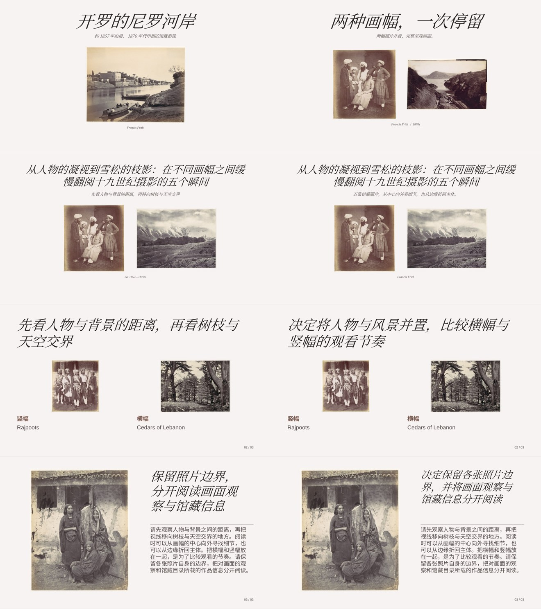

# 摄影作品集的首次输入验收

| 作品 | 首次可渲染版本 | 最终可编辑文件 | 最终实际预览 |
| --- | --- | --- | --- |
| 开罗的尼罗河岸 · 1 图 | [首次 PNG](runs/river-2/deck.pptx.review-B9yTpN/slide-1.png) · [PPTX](runs/river-2/deck.pptx) | [单图 PPTX](runs/river-3/deck.pptx) | [第 1 页](runs/river-3/deck.pptx.review-pGUKo3/initial/review/slide-1.png) |
| 两种画幅，一次停留 · 2 图 | [首次 PNG](runs/pair-2/deck.pptx.review-EpOpHT/slide-1.png) · [PPTX](runs/pair-2/deck.pptx) | [双图 PPTX](runs/pair-3/deck.pptx) | [第 1 页](runs/pair-3/deck.pptx.review-vDhmyq/initial/review/slide-1.png) |
| 人物与雪松 · 5 图 3 页 | [首组总览](runs/reading-5/deck.pptx.review-GqS4mv/initial/review/contact.png) · [PPTX](runs/reading-5/deck.pptx) | [新版本 PPTX](runs/reading-7/deck.pptx) | [封面](runs/reading-7/deck.pptx.review-V7tCeU/initial/review/slide-1.png) · [比较](runs/reading-7/deck.pptx.review-V7tCeU/initial/review/slide-2.png) · [说明](runs/reading-7/deck.pptx.review-V7tCeU/initial/review/slide-3.png) |
| 人物与雪松 · 独立重复 | [首次重复总览](runs/reading-6/deck.pptx.review-pay9Ua/initial/review/contact.png) · [含事实错误的原 PPTX](runs/reading-6/deck.pptx) | [重复生成 PPTX](runs/reading-8/deck.pptx) | [封面](runs/reading-8/deck.pptx.review-M7SOdP/initial/review/slide-1.png) · [比较](runs/reading-8/deck.pptx.review-M7SOdP/initial/review/slide-2.png) · [说明](runs/reading-8/deck.pptx.review-M7SOdP/initial/review/slide-3.png) |

## 输入和生成的边界

用户提供可使用的照片，以及主题、参考材料或指定的首页标题。要保留特定事实、署名、作品名和出处，需提供原文。页数有默认值 8，范围 1–20，本轮主动选了 1 或 3。普通简报与材料用于生成内容，可能被概括。指定首页标题（120 字以内）和末页正文（220 字以内）有独立字段，可逐字核对。末页原文用于摄影封面、作品或说明页，大纲产生不兼容的末页时会保留输入并提示重试。系统无法从任意散文可靠推导所有排版指令或授权。

从「办公 → 新建演示文稿 → 摄影素材与指定原文」一次导入最多 12 张 JPEG/PNG。大纲模型提出页序及页面角色。系统先给指定角色预留照片数量，剩余照片在符合条件的封面、作品、对比、说明页之间均分，按照导入顺序连续取图。无法满足明确数量时保留材料并报告冲突。五图封面默认把中间顺位放大，双图使用等权画框。默认完整显示，留出宽高比造成的空白；工作室支持逐图调整排序、裁切与焦点。本轮没有对生成的页面操作这些控件。系统不会自行挑选最有表现力的照片，默认也不会识别人脸或把眼睛设为焦点。

用户可指定设计方向、品牌强调色等已有偏好。摄影方向复用暖白底、衬线斜体标题和图文分栏。具体字号、行高、图框和留白由 Planner 按内容容量产生，Canvas 与原生导出使用同一份初始构图。测量后的局部修复只更新导出物，Biscuit 源稿仍保留首次设计，可再次导出。图注明确对应单张作品时可沿用逐图图注。封面署名则位于整组图下方。

新的逐图来源格式是每行「文件名或不含扩展名的文件名 | 出处」。匹配行逐字追加到对应幻灯片的 PPTX 备注，原模型备注同时保留。进行画幅比较时，如果恰有两张图且两份记录均为「文件名 | 作者 | 作品名 | 日期 | URL」，系统从图片像素测量方向，逐栏绑定原作品名。该步骤可以直接生成正文。自由文本、条目不全或存在歧义时仍走原模型路径。图像主题、拍摄地和人物身份仍需来源依据。

## 以前需要人工做什么

在 #17 的人像和海景样例里，开发者选图、排好顺序、指定每页角色与照片数，校对文案和备注，并为封面选择填满裁切。首轮看图后调整了通用的图下署名间距和说明页左右分栏，随后重新导出。原样例没有逐页写入绝对坐标，也没有实现自动看图后修复。此次读书会的输入预先指定了素材顺序、文案和页数，保留完整图片。没有指定页序、主图、焦点或页面坐标。[上轮生成记录及前后实图](../phase-3/acceptance/README.md)

## 本次如何验证

基线是 #17 的 `cd63718`。首次导出前在 `77b3bc1` 冻结三组输入及重复方案。七张作品均来自 The Met 的 Francis Frith 馆藏，此前开发样例使用的是 Cameron 和 Le Gray。选择图片与撰写材料是验收准备。宽高统一按原比例缩放后保存，记录馆方公共领域标志、来源、原始文件摘要及输入 JPEG 摘要。[冻结输入](../../../evals/presentation/photo-pilot/cases.json) · [逐幅来源与尺寸](../../../evals/presentation/photo-pilot/sources.json)

每次独立生成均从新的 Linux Electron 配置打开工作室，使用实际配置的 deepseek-flash、大纲、逐页正文、Canvas、保存源文件以及导出 PPTX。自动化填写输入，点击工作室按钮和操作系统保存路径；没有注入模型响应。已生成的页面修改次数全部为零。发生模型或大纲约束错误时，验收脚本最多再点一次生成按钮，记录错误与截图。重新开发规则后的全新生成与同一次导出的排版修复在下表分开统计。[可复跑的工作室脚本](../../../evals/presentation/photo-pilot/run.mjs)

单图与双图首轮使用 `79208e6` 的输入流程。单图首次输出少了原始 URL，双图首次输出已有两个链接。`58a28ba` 将匹配来源行固定到导出备注。相同五图材料在该版本两次形成了没有照片的比较页，其中第二次（reading-6）把人物标成横幅、树景标成竖幅。基础预检两次都通过。该版本保留供诊断，带错稿不宜对外使用。`b323d6d` 接入带实图的比较页和馆藏绑定后，同一输入重新从头生成两次，均在左栏展示竖幅 *Rajpoots*、右栏展示横幅 *Cedars of Lebanon*。原文标题和末页说明两次均完整。此修正由产品代码生效，无人调整单页。封面措辞和说明页换行在重复运行中仍不同。

### 每一次工作室启动与重试

| 运行 | 全程耗时 | 生成重试 / 导出修复 | 原始证据与结果 |
| --- | ---: | --- | --- |
| pair-1 | 31.4 s | 0 / — | 测试驱动未选中页数，尚未调用模型。[日志](runs/pair-1/run.json) · [现场](runs/pair-1/failure.png) |
| pair-2 | 26.5 s | 0 / 0 | 基础检查通过。[日志](runs/pair-2/run.json) · [PPTX](runs/pair-2/deck.pptx) · [源稿](runs/pair-2/source.deck.json) · [报告](runs/pair-2/deck.pptx.review-EpOpHT/report.json) · [P1](runs/pair-2/deck.pptx.review-EpOpHT/slide-1.png) |
| pair-3 | 23.0 s | 0 / 0 | 基础检查通过。[日志](runs/pair-3/run.json) · [PPTX](runs/pair-3/deck.pptx) · [源稿](runs/pair-3/source.deck.json) · [报告](runs/pair-3/deck.pptx.review-vDhmyq/report.json) · [P1](runs/pair-3/deck.pptx.review-vDhmyq/initial/review/slide-1.png) |
| reading-1 | 31.4 s | 0 / — | 测试驱动未选中页数，尚未调用模型。[日志](runs/reading-1/run.json) · [现场](runs/reading-1/failure.png) |
| reading-2 | 31.4 s | 0 / — | 测试驱动未选中页数，尚未调用模型。[日志](runs/reading-2/run.json) · [现场](runs/reading-2/failure.png) |
| reading-3 | 50.5 s | 0 / — | 正文生成期间 Electron 连接关闭，未导出。并发 Xvfb 编号冲突是推测；改用各自独立的显示号。[日志](runs/reading-3/run.json) |
| reading-4 | 26.9 s | 0 / — | 正文生成期间 Electron 连接关闭，未导出。并发 Xvfb 编号冲突是推测；改用各自独立的显示号。[日志](runs/reading-4/run.json) |
| reading-5 | 52.8 s | 0 / 0 | 基础检查通过；第 2 页讲对比却没有照片。[日志](runs/reading-5/run.json) · [PPTX](runs/reading-5/deck.pptx) · [源稿](runs/reading-5/source.deck.json) · [报告](runs/reading-5/deck.pptx.review-GqS4mv/report.json) · [P1](runs/reading-5/deck.pptx.review-GqS4mv/initial/review/slide-1.png) · [P2](runs/reading-5/deck.pptx.review-GqS4mv/initial/review/slide-2.png) · [P3](runs/reading-5/deck.pptx.review-GqS4mv/initial/review/slide-3.png) |
| reading-6 | 58.0 s | 1 / 0 | 基础检查通过；第 2 页横竖幅事实错误，归档为评审草稿。[日志](runs/reading-6/run.json) · [PPTX](runs/reading-6/deck.pptx) · [源稿](runs/reading-6/source.deck.json) · [报告](runs/reading-6/deck.pptx.review-pay9Ua/report.json) · [P1](runs/reading-6/deck.pptx.review-pay9Ua/initial/review/slide-1.png) · [P2](runs/reading-6/deck.pptx.review-pay9Ua/initial/review/slide-2.png) · [P3](runs/reading-6/deck.pptx.review-pay9Ua/initial/review/slide-3.png) |
| reading-7 | 45.6 s | 0 / 0 | 基础检查通过。[日志](runs/reading-7/run.json) · [PPTX](runs/reading-7/deck.pptx) · [源稿](runs/reading-7/source.deck.json) · [报告](runs/reading-7/deck.pptx.review-V7tCeU/report.json) · [P1](runs/reading-7/deck.pptx.review-V7tCeU/initial/review/slide-1.png) · [P2](runs/reading-7/deck.pptx.review-V7tCeU/initial/review/slide-2.png) · [P3](runs/reading-7/deck.pptx.review-V7tCeU/initial/review/slide-3.png) |
| reading-8 | 59.6 s | 1 / 0 | 基础检查通过。[日志](runs/reading-8/run.json) · [PPTX](runs/reading-8/deck.pptx) · [源稿](runs/reading-8/source.deck.json) · [报告](runs/reading-8/deck.pptx.review-M7SOdP/report.json) · [P1](runs/reading-8/deck.pptx.review-M7SOdP/initial/review/slide-1.png) · [P2](runs/reading-8/deck.pptx.review-M7SOdP/initial/review/slide-2.png) · [P3](runs/reading-8/deck.pptx.review-M7SOdP/initial/review/slide-3.png) |
| river-1 | 31.4 s | 0 / — | 测试驱动未选中页数，尚未调用模型。[日志](runs/river-1/run.json) · [现场](runs/river-1/failure.png) |
| river-2 | 19.4 s | 0 / 0 | 基础检查通过；备注遗漏 URL。[日志](runs/river-2/run.json) · [PPTX](runs/river-2/deck.pptx) · [源稿](runs/river-2/source.deck.json) · [报告](runs/river-2/deck.pptx.review-B9yTpN/report.json) · [P1](runs/river-2/deck.pptx.review-B9yTpN/slide-1.png) |
| river-3 | 21.5 s | 0 / 0 | 基础检查通过。[日志](runs/river-3/run.json) · [PPTX](runs/river-3/deck.pptx) · [源稿](runs/river-3/source.deck.json) · [报告](runs/river-3/deck.pptx.review-pGUKo3/report.json) · [P1](runs/river-3/deck.pptx.review-pGUKo3/initial/review/slide-1.png) |

工时从启动 Electron 起计，包含模型等待、源稿保存、PPTX 导出和首轮预检。reading-6 正文有一次模型格式错误；reading-8 的首轮大纲与指定末页原文冲突。均通过点击原工作室的生成按钮重试。表中 6 次未能导出文件的启动保留了原始错误，无法提供这些运行的 PPTX 或导出预览。输入驱动定位错误和显示服务中断与内容错误分开记录。同一输入的重新生成包含新的模型采样，不能将不同措辞都归因于布局改动。

## 局部修复及草稿

摄影导出的首次 PPTX、PDF、逐页 PNG 和报告保存在独立目录。只对确定性检查定位到具体文本框的裁切或越界进行一次局部调整。如果需要，最多再尝试一次适合该摄影版式的文本重排。每次实际重渲染；只有确定性问题减少、没有新增确定性告警或渲染警告的候选可替换前一版本。非适用版式或图表不强行重排。仍有阻断时另存草稿，原目标保留；成功覆盖已有目标时也归档前一份 PPTX。模型意见不会触发修复。本轮用户案例均未触发导出版式修复，曾出现的事实错误只能由生成规则修正。

另用真实导出链路运行独立工程夹具。以下重复文字与密集图注用于强制经过异常路径，分开归档。早期回退候选在修正标题后引入正文重构告警，未获采纳。当时的首版、失败候选和草稿均在目录中；后续收紧回退栏的边界至设计令牌的页边距，重新运行了全套断言。[早期被拒候选](regressions/biscuit-photo-delivery-3v2bU1/作品.pptx.review-cpf4UC/report.json) · [早期专项失败日志](checks/fixtures.log)

| 工程夹具 | 首次与最终文件 | 观察到的行为 |
| --- | --- | --- |
| 密集作品页、说明页和可编辑图表 | [首次 PPTX](regressions/verified/biscuit-photo-delivery-OpN9l1/作品.pptx.review-LRFCD8/initial/deck.pptx) · [首次预览](regressions/verified/biscuit-photo-delivery-OpN9l1/作品.pptx.review-LRFCD8/initial/review/contact.png) · [最终 PPTX](regressions/verified/biscuit-photo-delivery-OpN9l1/作品.pptx) · [最终预览](regressions/verified/biscuit-photo-delivery-OpN9l1/作品.pptx.review-LRFCD8/fallback/review/contact.png) | 6.4 秒，局部修复一次、回退一次，三轮均实际渲染。文本、备注、照片和原生裁切保留，图表工作表仍含数值零。[各轮记录](regressions/verified/biscuit-photo-delivery-OpN9l1/作品.pptx.review-LRFCD8/report.json) |
| 12 个过长图注 | [原稿预览＝草稿预览](regressions/verified/biscuit-photo-delivery-iZ0EcI/作品.pptx.review-9ztHz6/initial/review/contact.png) · [可编辑草稿](regressions/verified/biscuit-photo-delivery-iZ0EcI/作品.pptx.review-9ztHz6/draft.pptx) | 2.4 秒，两种策略均找不到可容纳的候选，实际重导出 0 次。12 个图注仍逐项有告警；目标位置保留原有效文件。[草稿报告](regressions/verified/biscuit-photo-delivery-iZ0EcI/作品.pptx.review-9ztHz6/report.json) |
| 未提供渲染后端 | [可编辑草稿](regressions/verified/biscuit-photo-delivery-chP8yQ/作品.pptx.review-HRqOgV/draft.pptx) | 0.01 秒，修复 0 次。模拟不可用的检查后端，无可用 PNG。[原因](regressions/verified/biscuit-photo-delivery-chP8yQ/作品.pptx.review-HRqOgV/report.json) |

## 自动检查、看图复核与平台缺口

- **文件核对。** 审计逐页比对报告哈希、实际 PPTX 图片关系、相应的导入 JPEG 字节、独立图片数、标题、正文与备注中的来源 URL。四份最终稿均完整保留固定标题和所有照片，五图稿的末页原文逐字匹配。保存的 source.deck.json 可重新在 Biscuit 打开。[文件审计](audit.json) · [复核脚本](../../../evals/presentation/photo-pilot/audit.py)
- **真实应用编辑。** Linux Impress 打开四份最终稿，在工作副本上改标题、移动及裁切一张照片，另存 PPTX 后重新打开。八页的改字与单张图片修改均已持久化，相邻照片位置与裁切保持不变。中文标题在 Impress 中显示为 Noto Serif CJK SC 的斜体属性，PDF 报告实际列出 Noto Serif CJK sc Regular，不能据此认定安装了中文原生斜体字形。照片首次均为完整显示。PowerPoint、Keynote 和 macOS Electron 的本轮打开、编辑、字体及放映未经验证。[Impress 编辑记录](impress.json)
- **视觉检查。** 额外从工作室重新打开 reading-7 的同一源稿，启用 Visual Critic 导出。三张 PNG 的哈希与对应交付稿完全相同。首次模型返回 JSON 解析错误，没有完成任何一页。保留首报，再对同一批截图逐页补查，三页均取得意见。第 1 页所报“间”越过底边并碰到副标题属误报：PDF 提取的标题下沿 130.6 pt，副标题上沿 136.7 pt。第 3 页所报末行截断也属误报，完整正文可还原，文字最下沿 416.8 pt，框底 474 pt。第 1 页日期归属、第 2 页断句及两条图注对齐意见留作编辑取舍；双图标题左齐各自栏位，照片因完整显示而在栏内居中。[首次报告](checks/reading-7-critic/deck.pptx.review-K5YhBe/report.json) · [补查七条意见](checks/reading-7-critic/critic-retry.json) · [实测文字边界](checks/reading-7-critic/text-bounds.json)
- **实际作品观察。** 单图的船和两侧河岸完整。双图海湾的左右山坡与人像的边界均可见。五图比较页的作品名称与照片一一对应；两种宽高比产生不同的可见宽度。长中文标题可读，但 reading-8 连续两页以“决定”起句，长标题仍按可用宽度自动换行。封面日期能否让观众理解为整组的年代范围，仍值得人工审阅。上述为助理核图记录。没有取得独立摄影编辑、用户或观众的审美评价；不能据此估计稳定交付率。
- **工程结果。** 本地 66 项桌面 Node 测试、16 项 Python 演示文稿测试和渲染器构建通过。完整 Electron 冒烟曾在办公前的窗口尺寸断言中断，另以单独的 1920 × 1080 Xvfb 显示重跑，五种窗口尺寸、工作室导出与其他冒烟步骤通过。等待人工审查的依赖顺序为 #14 → #15 → #16 → #17 → 本分支。#16、#17 均为 Draft；各八项作业成功，发布作业按条件跳过。[桌面测试](checks/final-node.log) · [Python 测试](checks/full-python.log) · [Electron 冒烟](checks/electron.log)

复跑材料位于 evals/presentation/photo-pilot。配置一个真实的工作室模型及 Linux 渲染后端后，在每个独立显示服务上运行 `node evals/presentation/photo-pilot/run.mjs reading <新的输出目录>`。脚本拒绝覆盖已有运行。模型措辞和运行时间可能变化。使用 `python evals/presentation/photo-pilot/audit.py` 可独立复核已交付文件，无需调用模型。

### 人工审查用的逐条视觉裁定

以下裁定来自对 reading-7 实际导出 PNG 的复核。三页模型原话、与截图的哈希对应关系和 PDF 文字边界均保留在上面的补查记录中。

| 页 | 模型提出的问题 | 核图结果 |
| --- | --- | --- |
| 1 | 标题末字「间」越过标题底边 | 误报。字形完整；末行文字下沿 130.6 pt，框底 136 pt。 |
| 1 | 第二行标题侵入副标题 | 误报。两行文字之间可见底色，标题下沿与副标题上沿相隔约 6.1 pt。 |
| 1 | 日期像是左图的图注，归属不清 | 日期实际居中于两图下方。它代表整组年代范围，观众能否理解、是否需要加署名说明，属于编辑判断。 |
| 2 | 横竖幅的水平偏移和间距使画面对齐欠佳 | 不同画幅在等宽栏内完整居中，图像边缘的偏移确实不同。是否更喜欢拉齐可见边沿，应同时看主体和留白。 |
| 2 | 「再看树枝与／天空交界」断句生硬 | 截图确认「与」在上行末尾。标题可读，但停顿打断词组，是有实图依据的排字建议。 |
| 2 | 两块图注相对各自照片的左缩进不同 | 属实。图注左对齐栏首，两幅照片的可见左缘与栏首距离不同。作品名和方向仍对应正确；图注应跟随图片或整栏，有待设计审查。 |
| 3 | 正文底边切过末行，右侧「作品信息分开阅读。」被截 | 误报。放大原 PNG，末行「察和馆藏目录所载的作品信息分开阅读。」的字形下半部、末字及句号均完整可见。PDF 也能重构原文。 |

回归验证分两层。归档文件审计检查完整照片序列、逐页对象数量、图片关系及嵌入字节；两份终稿第 2 页的题名和方向逐幅与冻结的馆藏记录、宽高比比对。工作室生成单测使用横竖两幅、与素材顺序相反的来源行，并核对每栏文字与图片中心的对应关系。这覆盖试点中确定的缺图、错配与方向错误。自由文案中的人物身份、拍摄地或任意段落中的语义指代仍需来源复核。

### 远端 Linux 阻断及复现

提交 `6e96ce8` 的远端结果为七项成功、一项 Linux 失败、发布跳过。[原始 CI 作业](https://github.com/feiyuceng06-prog/Biscuit/actions/runs/45017651079/job/137193342250)

在 Ubuntu 22.04 的 LibreOffice 7.3.7、Poppler 上复现了两个差异。Poppler 有时按列输出同一文本框的字词，导致完整段落被误报裁切；另一个密集图注夹具在旧版 Impress 中被自动缩字，因而没有按 Planner 的字号暴露实际越界。修正后，首次匹配失败会再按该框内的行位置与横向顺序匹配完整原文；摄影逐图图注按规划字号导出。既有修复夹具在原生导出前固定两处过小的框，产生可测量的真实缺陷，两种渲染器均需先局修、再回退。12 个过密图注仍须逐一报告，且草稿不得覆盖已有文件。该步骤在本地 26.8 和 Ubuntu 7.3.7 重放通过。CI 将各轮导出留在诊断附件。以上更改没有重写四份用户终稿或历史报告。
