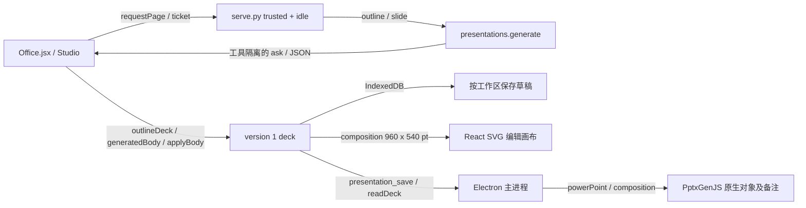

# 演示文稿导出基线

## Phase 0 架构核对

基线提交 `cd490c8`。用户输入材料和 brief，经以下调用链生成演示文稿。



- 模型生成接口限制为 1–20 页，已有六种布局和三种主题。编辑器支持逐页生成、重试、终止接收、调整页序、撤销与 JSON 往返。revision 防止旧响应覆盖新编辑。
- 页面和条目已有 ID。布局以点表示边框和字号，导出时位置换算为英寸。图表保留原生数据，图片使用内嵌数据，字体由 PowerPoint 阅读环境解析。
- 保存对话框和临时文件重命名由主进程控制。原流程没有打开导出的文件，没有 PDF、逐页 PNG、视觉模型输入、导出后检查或预览缓存。批量生成依次复用单页请求，没有后台设计任务队列。
- 现有 Python 测试检查模型返回和信任边界，Node 测试覆盖草稿与布局，Electron smoke 检查编辑流程及导出。仓库自带夜读示例覆盖图片、原生图表和备注。
- 适配点选在原子保存之后。以原有 composition 提供内容绑定，用实际导出文件提供可见证据。保留既有编辑、重写及导出入口。

## 基准复现

在仓库根目录先运行 `(cd desktop && npm ci)`。安装已有 Python 依赖、LibreOffice Impress、Poppler 和中文字体。运行以下命令到两个新目录，再比较 baseline.json 各页 pngSha256。PPTX/PDF 可包含时间戳。

```sh
python evals/presentation/baseline.py /tmp/biscuit-before
python evals/presentation/baseline.py /tmp/biscuit-repeat
python -m unittest discover -s tests -p test_presentations.py
(cd desktop && node --test tests/office-deck.test.mjs)
```

briefs.json 固定 12 份用途、内容及布局，月报使用项目内虚构夜读素材。export.mjs 固定 ID 和模型输出，仍调用生产 powerPoint。耗时分别测量 PPTX 写入缓冲区与 LibreOffice/Poppler 生成并校验全部 PNG 的时间，不包含模型响应。封面、数据页和异常输入均保留在样本内。输出目录含完整草稿、PPTX、PDF、PNG 以及逐页哈希，docs/presentation/evidence 目录保留实测汇总与代表性样例。
